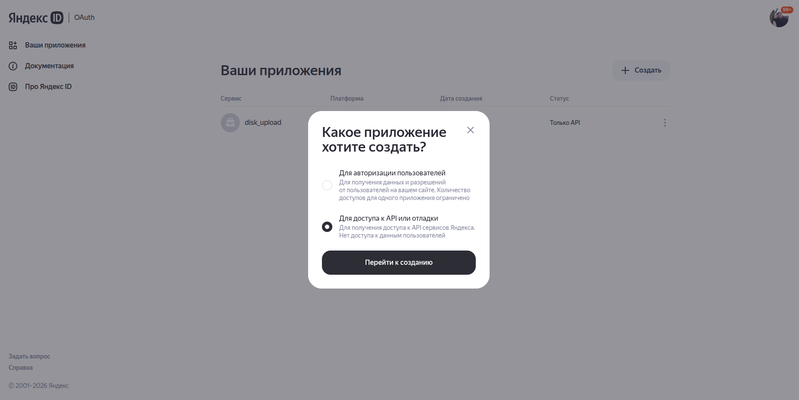
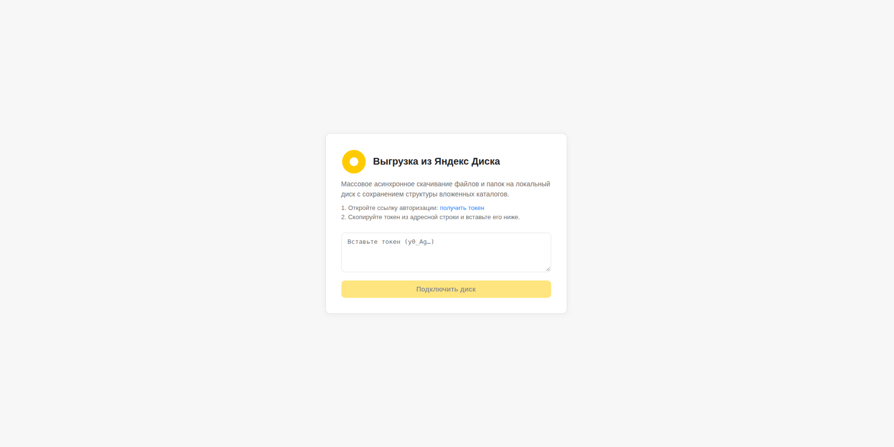
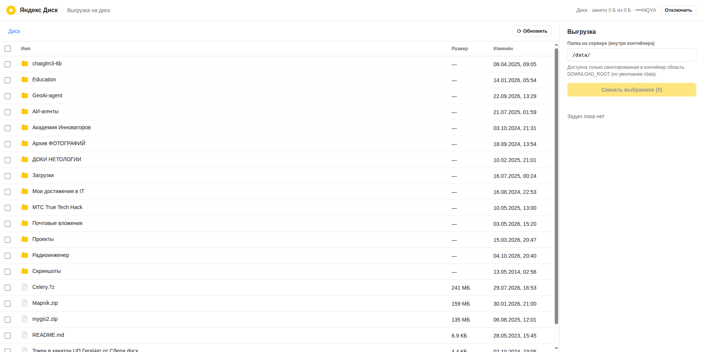
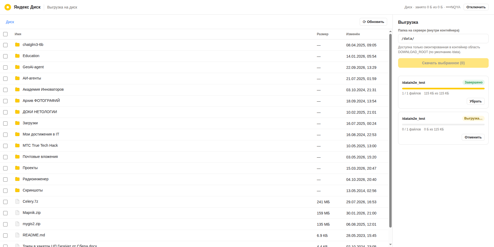
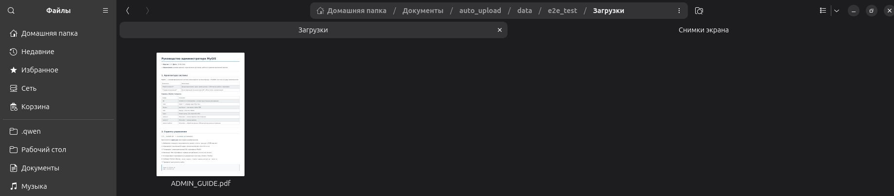

# Выгрузка из Яндекс Диска

Локальное веб-приложение для массового асинхронного скачивания файлов и папок
из Яндекс Диска на локальный диск с сохранением структуры вложенных каталогов.

Стек: **React (Vite) + Django REST Framework + Redis + Celery**, всё запускается в Docker.

## Возможности

- Подключение диска по OAuth-токену (implicit-флоу, токен вставляется в веб-форму).
- Просмотр структуры диска: папки, файлы, размеры, даты; выбор чекбоксами —
  одной папки, нескольких папок или отдельных файлов.
- Массовая выгрузка выбранных объектов с сохранением структуры (путь файла на
  диске зеркалится относительно корня в папке назначения).
- 8 параллельных загрузок (настраивается), ограничение частоты запросов к API,
  ретраи на 429/5xx.
- Живой прогресс: файлы, байты, скорость; отмена выгрузки; список ошибок по файлам.
- История задач (последние 50), удаление из истории.

## Запуск

1. **Создайте OAuth-приложение Яндекса** (нужен Client ID):
   
   - откройте <https://oauth.yandex.ru/>, 

   

   - «Создать OAuth-приложение»,

   

   - скопируйте **Client ID**.

   
   
   > Client Secret для этого приложения **не нужен** и нигде не хранится
   > (используется implicit-флоу `response_type=token`).

2. Настройте окружение:

   ```bash
   # впишите YANDEX_CLIENT_ID в .env.example
   # и выполните
   cp .env.example .env
   ```

3. Соберите и запустите:

   ```bash
   docker compose up -d --build
   ```

4. Откройте <http://localhost:8080>:
   

   - нажмите «получить токен» (откроется авторизация Яндекса, пройдите ее),
   - после авторизации вы перейдете на страницу и увидите токен авторизации, скопируйте его,
   - вставьте скопированный токен в форму и подключите диск,
   - выберите файлы/папки, укажите папку назначения и нажмите «Скачать выбранное».
  
   

   ---

   

   ---

   

### Параметры (в `.env`)

| Переменная             | По умолчанию | Описание                                        |
| ---------------------- | ------------ | ----------------------------------------------- |
| `YANDEX_CLIENT_ID`     | —            | Client ID OAuth-приложения (обязательно)        |
| `DOWNLOAD_ROOT`        | `/data`      | Корень, внутри которого можно указывать папку назначения |
| `DOWNLOAD_CONCURRENCY` | `8`          | Число параллельных загрузок (concurrency воркера) |
| `API_QPS`              | `4`          | Лимит запросов к API Яндекса, запросов/сек      |

## Как устроено

```
frontend (nginx + React SPA)
   │  /api → proxy
backend (Django + DRF, uvicorn)
   │  создаёт задачу, ставит core.tasks.run_download в очередь
celery worker (8 потоков)
   │  run_download: рекурсивно раскрывает дерево (API Яндекса)
   │  → на каждый файл: download_file (параллельно, 8)
   │  → прогресс/отмена/ошибки — ключи в Redis
redis
   │  broker Celery, счётчики прогресса, rate-limit, флаги отмены
./data  (volume) — папки назначения, файлы пишутся в dest/<путь от корня диска>
```

- Папка назначения в приложении может быть только внутри `DOWNLOAD_ROOT`
  (защита от выхода за пределы смонтированного тома).
- Файлы пишутся в `.part`-файл и атомарно переименовываются — после отмены или
  сбоев не остаётся «половинчатых» файлов.
- Токен хранится в SQLite (`var/db.sqlite3`), в ответах API возвращается только
  маска. Токен не логируется.

## Тесты

```bash
docker compose run --rm backend pytest
```

## Обновление после правок кода

В этом стеке код не монтируется в контейнеры — после изменений:

```bash
docker compose up -d --build
```

## Безопасность

- Приложение **не имеет авторизации**: порт `8080` слушается только на
  `127.0.0.1`. Если нужно открыть доступ из сети — поставьте reverse-proxy с
  аутентификацией.
- `.env` не коммитится; в `.env.example` только плейсхолдеры.
- Токен Яндекса хранится в БД в открытом виде (локальный инструмент). Файл
  `var/db.sqlite3` стоит защитить правами (например, `chmod 600`), если к
  хосту есть доступ у других пользователей.
